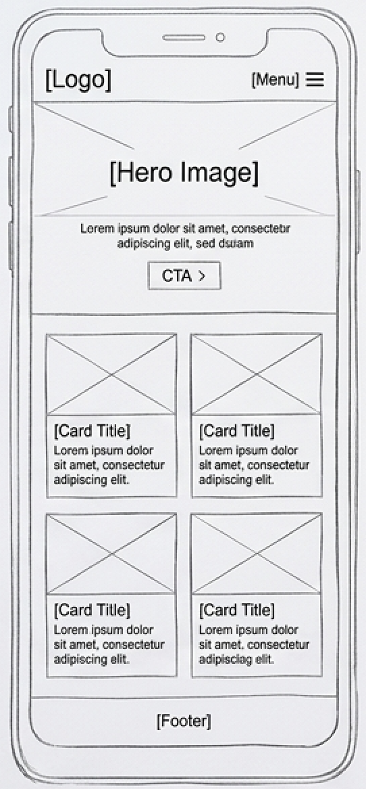
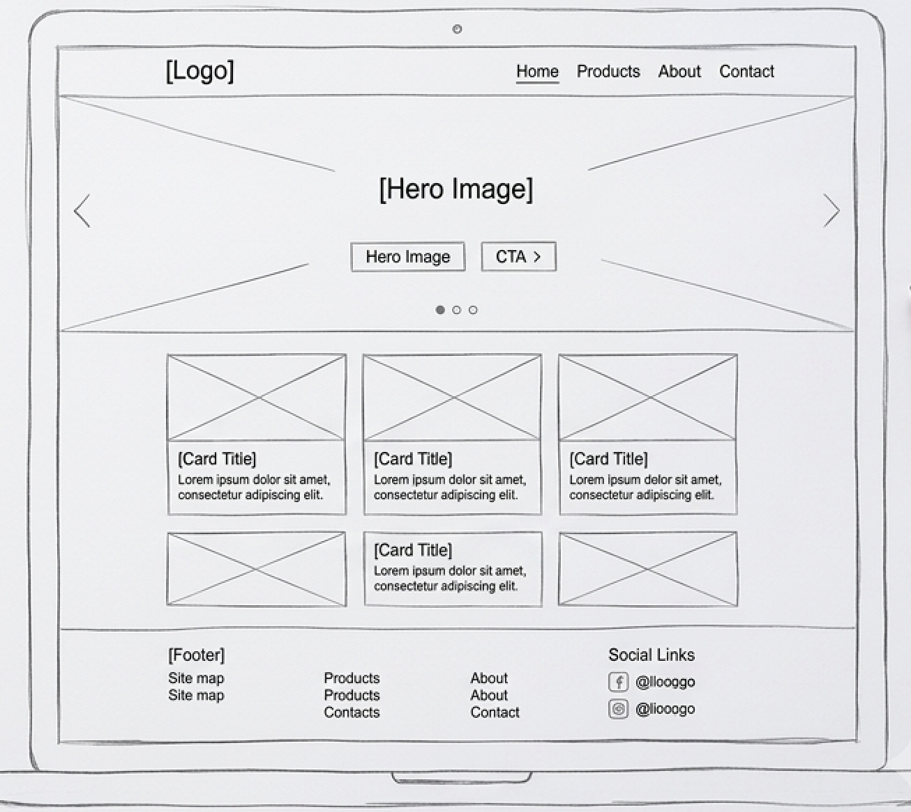

# Bản Phác Thảo Thiết Kế Web - Mã Hóa Từ Đầu

## 1. Tổng quan
Dự án này trình bày các bản phác thảo wireframe ban đầu cho một trang web phản hồi được thiết kế từ đầu. Dự án bao gồm hai giao diện độc đáo: Chế độ xem Di động (Mobile View) và Chế độ xem Màn hình lớn (Desktop View).

## 2. Phân Tích Thiết Kế

### Chế độ Di động 
- **Bố cục:** Bố cục dọc 1 cột được tối ưu hóa riêng cho màn hình di động.
- **Header:** Chứa logo và menu điều hướng thu gọn dạng Hamburger (`[Menu] ☰`).
- **Nội dung chính:** Phần Hero kèm nút kêu gọi hành động, phía dưới là các thẻ nội dung xếp chồng giúp dễ dàng cuộn theo chiều dọc.
- **Footer:** Chân trang thu gọn chứa các thông tin cơ bản.

### Chế độ Màn hình lớn 
- **Bố cục:** Bố cục dạng lưới (grid) nhiều cột, tận dụng tối đa không gian màn hình rộng.
- **Header:** Thanh điều hướng dàn ngang đầy đủ (`Trang chủ`, `Sản phẩm`, `Giới thiệu`, `Liên hệ`).
- **Nội dung chính:** Banner ảnh Hero mở rộng có nút chuyển hướng và lưới thẻ nội dung dạng 3 cột hiển thị các thông tin nổi bật.
- **Footer:** Chân trang mở rộng đầy đủ với sơ đồ trang web và các liên kết mạng xã hội.

## 3. Bản Phác Thảo 

### Giao diện Di động

### Giao diện Màn hình lớn
